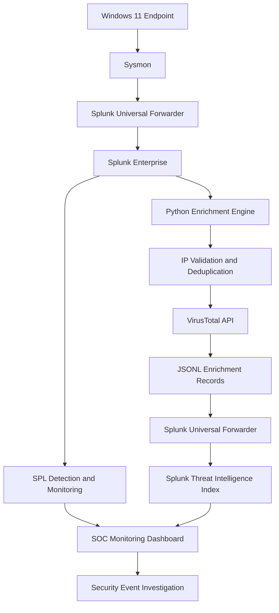

# SOC Monitoring, Detection & Threat Intelligence Lab

An end-to-end Security Operations Center (SOC) home lab built using Splunk Enterprise, Windows Sysmon, Python and VirusTotal.

This project focuses on collecting Windows endpoint telemetry, identifying suspicious activities through SIEM-based detection, enriching external IP addresses with threat intelligence, and providing a centralized dashboard for security monitoring and investigation.

## Project Objectives

- Centralize Windows endpoint telemetry in Splunk.
- Monitor process creation, network connections and DNS activity.
- Develop SPL-based detection use cases for common security events.
- Enrich public destination IP addresses using VirusTotal.
- Automate threat intelligence collection and ingestion.
- Correlate endpoint activity with external threat intelligence.
- Build a centralized dashboard for security monitoring and investigation.
- Practise evidence collection and security event analysis.

## Architecture

The project uses two connected workflows: endpoint telemetry collection and automated threat intelligence enrichment.



## Technology Stack

| Technology | Purpose |
|---|---|
| Splunk Enterprise | SIEM platform for log collection, searching and analysis |
| Windows Sysmon | Endpoint telemetry collection |
| Splunk Universal Forwarder | Collection and forwarding of endpoint and enrichment logs |
| Python | Threat intelligence automation and IP validation |
| VirusTotal API | External IP threat intelligence |
| Windows Credential Manager | Secure storage and retrieval of credentials |
| Docker Desktop | Splunk Enterprise deployment |
| SPL | Security detection, searching and investigation queries |
| Windows Task Scheduler | Scheduled execution of the enrichment script |

## Telemetry Collection

The lab monitors Windows endpoint activity using Sysmon and Windows event logs.

Important Sysmon event IDs:

| Sysmon Event ID | Description |
|---|---|
| 1 | Process Creation |
| 3 | Network Connection |
| 22 | DNS Query |

Sysmon captures process execution details, network connections and DNS activity.

Windows Security and System event logs are also collected to provide additional visibility into endpoint activity.

The Splunk Universal Forwarder collects the configured event channels and forwards the data to Splunk Enterprise.

## Detection Engineering

Four detection use cases were developed using Splunk Processing Language (SPL).

| Detection | Description |
|---|---|
| SOC-DET-001 | Windows Brute Force Login Detection using failed logon events (Event ID 4625) |
| SOC-DET-002 | Encoded PowerShell Execution detection using Sysmon Process Creation events |
| SOC-DET-003 | Suspicious Outbound Network Connections involving selected processes and public destination IPs |
| Outbound Network Anomaly | Identifies unusual outbound connection volumes by comparing activity against a historical baseline |

The detection searches use SPL filtering, field extraction, aggregation and correlation techniques.

Controlled lab activity was generated to validate selected detections.

These detections identify potentially suspicious behaviour and require analyst investigation. Encoded PowerShell execution or unusual network activity does not automatically indicate malicious activity.

The detection logic and anomaly thresholds are designed for a controlled learning environment and require further tuning before production deployment.

## Threat Intelligence Automation

Python was used to automate the enrichment of external destination IP addresses using the VirusTotal API.

The enrichment workflow consists of the following steps:

1. Connects to Splunk Enterprise through its REST API.
2. Retrieves recent Sysmon Event ID 3 network connection events from the previous 24 hours.
3. Extracts destination IP addresses and associated process and network details.
4. Validates IP addresses and excludes non-global and non-IPv4 destinations.
5. Checks the existing enrichment file to avoid processing previously enriched IP addresses.
6. Selects a maximum of three new public IPv4 addresses per execution.
7. Queries the VirusTotal API for available IP threat intelligence.
8. Extracts information including IP ownership, ASN, country, reputation and vendor analysis statistics.
9. Assigns a verdict and severity based on the returned malicious and suspicious detection counts.
10. Saves the enrichment results in JSON Lines (JSONL) format.

The two main Python scripts have separate responsibilities:

- `enrich_splunk_events.py` — retrieves events from Splunk, validates and deduplicates IP addresses, and coordinates the enrichment workflow.
- `vt_enrichment.py` — queries the VirusTotal API, processes the response and saves enrichment records.

The enrichment file is monitored by Splunk Universal Forwarder. New records are forwarded to a separate Splunk index named `threat_intel`.

Windows Credential Manager is used to store and retrieve Splunk and VirusTotal credentials instead of hardcoding them in the Python source code.

A Windows Task Scheduler task was configured and tested to execute the enrichment workflow every 30 minutes. It can be enabled when recurring enrichment is required.

## Splunk Dashboard

A centralized dashboard was created in Splunk Enterprise under the name **Enterprise SOC Monitoring & Incident Response**.

Its purpose is to provide visibility into endpoint activity, network connections and threat intelligence results.

The dashboard includes:

- VirusTotal Enriched Destinations
- Unique Enriched IPs
- Malicious IPs
- Suspicious IPs
- Total Network Connections
- Top Destination IPs
- VirusTotal Verdict Distribution
- Recent Endpoint Events
- Threat Intelligence Coverage
- Outbound Network Anomalies
- Process-wise Network Activity
- Incident Investigation Queue

The dashboard helps an analyst review security events, examine enrichment results and identify activity that may require further investigation.

## Security Event Investigation

A documented investigation case is included:

**SOC-IR-001 — Potential Suspicious Outbound Connection**

This case study demonstrates how endpoint telemetry and external threat intelligence can be used together to investigate a potentially suspicious network connection.

The investigation examines:

- VirusTotal IP threat intelligence.
- Sysmon Event ID 3 network connection events.
- Sysmon Event ID 1 process creation events.
- Process GUID correlation.
- Parent process information.
- Command-line arguments.
- Available process hash information.

The investigated destination received one malicious vendor detection from VirusTotal. Additional endpoint context was examined to assess the activity.

The case remains classified as **Pending Validation** because the available evidence does not conclusively establish malicious execution.

No IP blocking or endpoint quarantine was performed.

This case study demonstrates the investigation and evidence-assessment process rather than a complete incident response lifecycle.

See `incident_case_001.md` for the investigation documentation.

## Project Structure

```text
enterprise-soc-monitoring-lab/
│
├── README.md
├── .gitignore
│
├── enrich_splunk_events.py
├── vt_enrichment.py
├── setup_credentials.py
│
└── incident_case_001.md
```

Sensitive enrichment records, raw endpoint telemetry, credentials and backup files are excluded from the public repository.

## Setup and Execution

### Prerequisites

- Windows 10/11
- Docker Desktop
- Splunk Enterprise
- Splunk Universal Forwarder
- Windows Sysmon
- Python 3
- VirusTotal API key

### Install Python dependencies

```powershell
py -m pip install requests urllib3 keyring
```

### Configure credentials

Run:

```powershell
py setup_credentials.py
```

Enter the Splunk username, Splunk password and VirusTotal API key when prompted.

The credentials are stored using Windows Credential Manager.

### Run the enrichment engine

```powershell
py enrich_splunk_events.py
```

The script retrieves recent network events from Splunk, extracts eligible public IPv4 destinations, avoids previously enriched IP addresses and performs VirusTotal lookups.

### Scheduled Execution

Windows Task Scheduler can be configured to execute the enrichment script periodically.

The lab was configured and tested with a 30-minute execution interval.

## Security Considerations

- API keys, passwords and authentication tokens must never be hardcoded into source files.
- Credentials are stored using Windows Credential Manager.
- Raw endpoint telemetry and enrichment records are excluded from the public repository.
- Sensitive endpoint information should be removed from screenshots and investigation reports before publication.
- The local Splunk REST API connection uses certificate verification disabled for this lab setup. Production deployments must use properly validated TLS certificates.
- VirusTotal reputation scores and vendor detections are intelligence signals, not definitive proof of malicious activity.
- Automated verdicts must be reviewed in the context of endpoint and network evidence.

## Current Limitations

- The lab monitors a single Windows endpoint.
- VirusTotal enrichment is limited to three new IP addresses per execution.
- IPv6 enrichment is not implemented.
- Outbound network anomaly thresholds are provisional and require further tuning.
- Detection alerts require false-positive review and refinement.
- A clean VirusTotal result does not guarantee that an IP address is safe.
- The project supports monitoring, detection, enrichment and investigation; it does not implement automated blocking, endpoint quarantine, eradication or recovery.
- This is an educational SOC home lab, not a production enterprise SOC deployment.

## Future Improvements

- Add additional monitored endpoints.
- Improve detection alert deduplication and suppression.
- Tune anomaly detection thresholds using longer historical baselines.
- Improve endpoint and threat intelligence correlation.
- Add structured investigation tracking and evidence reporting.
- Expand threat intelligence sources.
- Explore incident containment and response workflows in a controlled lab.

## Disclaimer

This project was developed for educational purposes and authorized security testing in a controlled lab environment.

It demonstrates fundamental SOC monitoring, detection engineering, threat intelligence enrichment and security investigation workflows. It is not intended to replace an enterprise-grade SIEM, SOC platform or professional incident response process.
